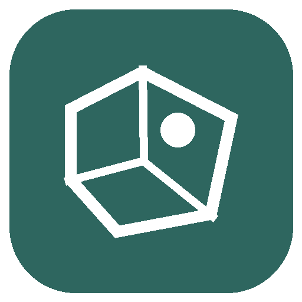

<p></p>

# Catastro Pro

## Una referencia. Una ficha clara.

Convierte una referencia catastral en una ficha con superficies, uso, construcción y coordenadas claramente identificadas.

**Para:** Arquitectos y profesionales inmobiliarios que contrastan datos descriptivos.

**Fuente:** Dirección General del Catastro · **Sin cuenta adicional ni API key** · **Python 3.11+** · **MIT**

### Qué obtienes

- Superficie construida y de parcela con sus unidades.
- Longitud y latitud normalizadas y validadas.
- Errores y varias unidades nunca ocultos tras un éxito aparente.

### Pruébalo con una pregunta

> Consulta la referencia 2749704YJ0624N0001DI y separa superficie construida y de parcela.

También: “Explica qué comprueba esta ficha y qué requiere Registro o Urbanismo.”

[Ver el informe de ejemplo](examples/demo.md) · [Código de la página del producto](docs/index.html) · [Flujo completo](skills/catastro-pro/references/workflow.md)

La demostración es una **captura guardada de fuentes oficiales**, no una consulta actual. Conserva fecha, enlaces y alcance.

## Instalar en Claude Code

```text
/plugin install catastro-pro --marketplace samihalawa/catastro-pro
```

O desde terminal:

```bash
claude plugin marketplace add samihalawa/catastro-pro
claude plugin install catastro-pro@catastro-pro
```

Después, pregunta en lenguaje natural o invoca `/catastro-pro:catastro-pro`.

## Ver un resultado sin conexión

Desde una copia de este repositorio:

```bash
python3 skills/catastro-pro/scripts/run.py demo
python3 skills/catastro-pro/scripts/run.py demo --format html --output ejemplo.html
```

## Consultar y guardar un informe

```bash
python3 skills/catastro-pro/scripts/run.py report catastro_ficha --json '{"reference": "2749704YJ0624N0001DI"}'
```

Añade `--format html --output informe.html` o `--format json`. No se sobrescriben archivos por defecto. `doctor` comprueba el entorno local sin consultar proveedores.

## Dónde funciona

| Entorno | Comportamiento |
|---|---|
| Claude Code / Codex con Python y red autorizada | Adaptadores e informes ejecutables. |
| ChatGPT con navegación/archivos | Flujo con herramientas nativas disponibles; no es un MCP alojado. |
| Sin red | Demo guardada o documentos aportados; no datos actuales inventados. |

## Alcance real

Solo datos no protegidos. No acredita propiedad, habitabilidad, valor o licencia urbanística. El punto no delimita una parcela. Navarra y País Vasco usan sistemas separados.

## Verificación

```bash
python3 -m unittest discover -s tests -v
python3 scripts/check_package.py
claude plugin validate --strict .claude-plugin/plugin.json
claude plugin validate --strict .
```

[Mejoras y crítica](CHANGELOG.md) · [Evidencia versionada](evidence/) · [Revisión de Claude](SUBMISSION.md). Los tests no equivalen a adopción. `ci/validate.yml` es una plantilla inactiva.

**English:** An independent workflow for Spanish official data, with a self-contained Python adapter, offline example and readable reports. Answer language follows the user.

**Sami Halawa** · Software independiente; sin afiliación oficial. [Privacidad](PRIVACY.md) · [Condiciones](TERMS.md) · [Soporte](SUPPORT.md) · [Seguridad](SECURITY.md).
