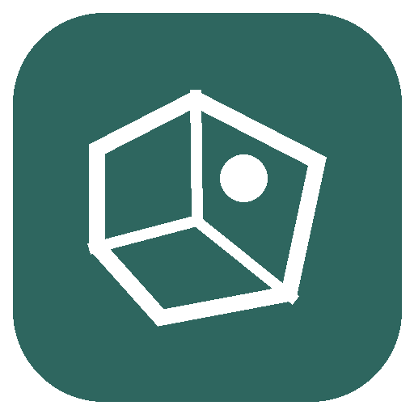

# Catastro Pro

Consulta hechos catastrales públicos de una referencia y coordenadas EPSG:4326; identifica fallos parciales sin certificar titularidad.

**Versión 0.6.3 · Conector MCP alojado e instrucciones complementarias · Sami Halawa · MIT**

## Instalación y uso

```bash
/plugin install catastro-pro --marketplace samihalawa/2026-MASTER-Marketplace-Plugins-Connectors-etc
```


Instala el paquete en un anfitrión compatible con plugins y MCP remoto. La configuración incluida conecta `https://aiplugins.megawebs.com/mcp/catastro-pro` mediante Streamable HTTP y expone `inspect_spanish_cadastral_property`. No necesitas Python local, instalar dependencias ni proporcionar una clave del editor. La disponibilidad de la conexión depende del anfitrión y de la fuente pública.

> Consulta la ficha pública de 2749704YJ0624N y cita la fuente.

- Consulta 2749704YJ0624N0001DI y distingue superficie y uso de titularidad.
- Consulta 2749704YJ0624N y etiqueta las coordenadas con su sistema de referencia.

Lee [la habilidad](skills/catastro-pro/SKILL.md) para el procedimiento, [las fuentes](skills/catastro-pro/references/sources.md) y [el contrato de acceso](skills/catastro-pro/references/runtime.md). La herramienta realiza la consulta acotada descrita; la lectura de documentos, interpretación y creación de archivos usan capacidades adicionales del anfitrión. Conserva los identificadores, enlaces, fechas y límites realmente devueltos.

## Alcance

No presenta solicitudes u ofertas, no firma, no compra, no consulta datos protegidos ni activa vigilancia. Una respuesta parcial o fallida no prueba ausencia de registros. No se garantiza elegibilidad, resultado jurídico, titularidad ni financiación.

Los [ejemplos guardados](examples/demo.md) son capturas históricas de versiones anteriores, no consultas actuales. El historial de 0.5.0 conserva la edición de instrucciones; 0.6.0 añade una conexión remota explícita y no reetiqueta esas capturas. La aprobación en un directorio se verifica por separado.

[Producto e instalación](https://aiplugins.megawebs.com/plugins/catastro-pro) · [Privacidad](https://aiplugins.megawebs.com/plugins/catastro-pro/privacy) · [Condiciones](https://aiplugins.megawebs.com/plugins/catastro-pro/terms) · [Soporte](https://aiplugins.megawebs.com/plugins/catastro-pro/support)
